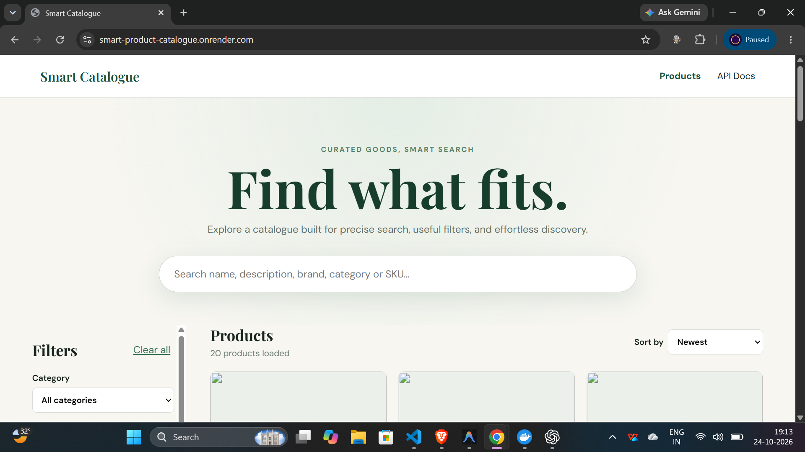
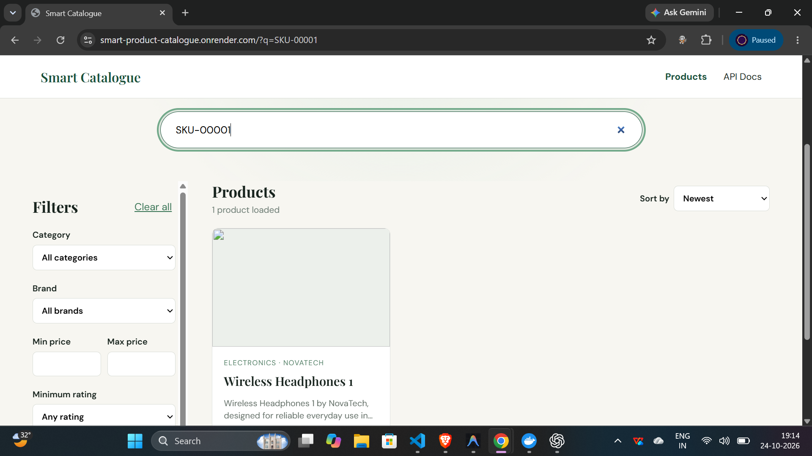
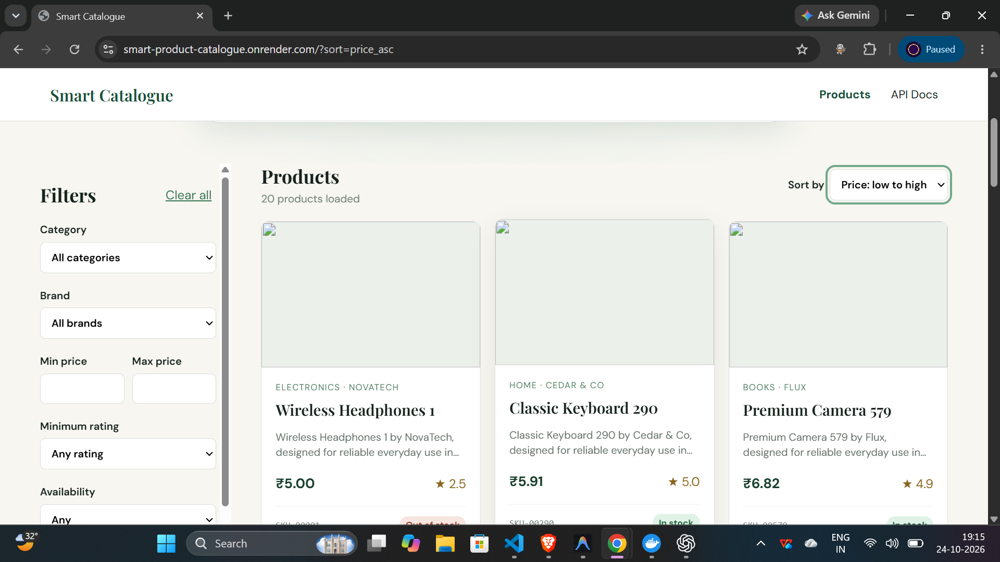

# Smart Product Search & Catalogue

**Search fast. Filter precisely. Browse seamlessly.**

A full-stack product discovery application built for the **Getto India Full Stack Developer technical assessment**. It combines a React storefront with a Node.js REST API and PostgreSQL to deliver case-insensitive search, composable filters, stable sorting, and cursor-based infinite scrolling.

Designed with practical engineering priorities in mind: validated inputs, parameterized SQL, predictable pagination, database indexes, and automated tests.

> **Project status:** A local-demo hyperlocal commerce application is implemented: global and location-aware discovery, variant/store fulfilment, multi-store cart and checkout reservation, orders, store operations, delivery assignment, ETA estimates, and Socket.IO-backed status updates. Stores, agents, delivery locations, and identities are simulated demo data; this is not a production delivery service.

## Project Overview

| Area | Implementation |
|---|---|
| Assessment | Smart Product Search & Catalogue System |
| Frontend | React 19, TypeScript, Vite |
| Backend | Node.js, Express 5, TypeScript |
| Database | PostgreSQL 16 |
| Database access | `pg` with parameterized SQL |
| Validation | Zod |
| Testing | Vitest, Supertest, React Testing Library |
| Local database | Docker Compose |
| Demo database | Local Docker PostgreSQL (`catalogue_dev`) |
| Realtime | Socket.IO with REST recovery |
| Sample data | 1,004 deterministic products, 10 Hyderabad demo stores, deterministic store inventory |
| Pagination | Server-side cursor-based keyset pagination |
| Repository | [smart-product-catalogue](https://github.com/thvvamshi/smart-product-catalogue) |

## Table of Contents

- [Features](#features)
- [Hyperlocal Commerce Foundation](#hyperlocal-commerce-foundation)
- [Architecture](#architecture)
- [Project Structure](#project-structure)
- [Prerequisites](#prerequisites)
- [Getting Started](#getting-started)
- [Environment Variables](#environment-variables)
- [Database Design and Seed Data](#database-design-and-seed-data)
- [Search Implementation](#search-implementation)
- [API Documentation](#api-documentation)
- [Pagination and Infinite Scrolling](#pagination-and-infinite-scrolling)
- [Validation and Error Handling](#validation-and-error-handling)
- [Database Indexing and Performance](#database-indexing-and-performance)
- [Testing](#testing)
- [Security](#security)
- [Deployment](#deployment)
- [Screenshots](#screenshots)
- [Scalability Considerations](#scalability-considerations)
- [Known Limitations](#known-limitations)
- [Assessment Alignment](#assessment-alignment)
- [Contributing](#contributing)
- [License](#license)

## Features

### Product catalogue

- Relational PostgreSQL database with more than the required 500 products.
- Unique product IDs and SKUs.
- Product names, descriptions, brands, categories, prices, ratings, stock status, creation dates, and image URLs.
- Seed script with deterministic sample data and repeatable SKU-based upserts.
- Product detail endpoint.
- Responsive catalogue interface with product image fallbacks.

### Search and filtering

- Case-insensitive partial-text search across product name, description, brand, category, and SKU.
- Combined filters for category, brand, minimum price, maximum price, minimum rating, and stock availability.
- All selected filters are applied together using SQL `AND` conditions.
- Sorting by price ascending, price descending, rating descending, newest first, and name A–Z.
- Debounced search input.
- URL-persisted search criteria and sorting.
- Clearable search and filters.
- Loading, empty-result, error, and retry states.
- Protection against stale search responses using request cancellation and request-generation tracking.

### Pagination

- Server-side cursor-based pagination.
- Default batch size of 20 products, with a maximum of 100.
- Automatic loading of subsequent batches using `IntersectionObserver`.
- Stable ordering when multiple products share the same sort value.
- Cursor validation and sort consistency checks.
- No separate total-count query on each catalogue request.

## Hyperlocal Commerce Foundation

The original location and store-domain foundation now supports the complete local-demo commerce workflow documented below. Payments, production authentication, external routing, and production courier integrations remain intentionally out of scope.

> **Demo data disclaimer:** every seeded store and inventory record is simulated. Store names are synthetic, all stores have `is_demo = true`, and none are represented as Getto partners or real businesses.

### Database relationships

```text
products (catalogue entity)
    1
    |
    |< store_inventory >|
                          |
                          many
                        stores
```

Global product identity and catalogue price remain on `products`. `store_inventory` owns store-specific stock, availability, and selling price, allowing one product to be offered by many stores without adding location fields to the product table.

The additive migration creates:

- `schema_migrations`, which records each successfully applied migration filename.
- `stores`, including validated numeric coordinates, delivery radius, preparation time, active/demo flags, and public address fields.
- `store_inventory`, with foreign keys, a unique `(store_id, product_id)` pair, non-negative stock, and non-negative selling price.
- Indexes for active city discovery, coordinate searches, store inventory lookup, and product-to-store lookup.

### Migration and seed workflow

Run database operations explicitly and in order:

```bash
npm run db:schema -w server
npm run db:migrate -w server
npm run db:seed -w server
npm run db:seed-hyperlocal -w server
npm run db:verify-count -w server
npm run db:verify-hyperlocal -w server
```

Migrations are read from `server/database/migrations/` in filename order. Every pending migration runs in its own transaction and is recorded only after success; failures roll back and already-applied migrations are skipped. Migrations never drop or truncate catalogue data.

The hyperlocal seed upserts 10 deterministic Hyderabad demo stores by store code and inventory by `(store_id, product_id)`. It refuses non-local database targets unless the operator deliberately adds `--allow-remote`:

```bash
npm run db:seed-hyperlocal -w server -- --allow-remote
```

Always review the target connection before using that flag. Production schema/seed operations are one-time operational tasks and do not run during application startup.

### Customer location experience and privacy

The navbar location selector supports:

- Native browser geolocation only after the customer clicks **Use my current location**.
- High-accuracy requests with a 10-second timeout and a 60-second maximum cached age.
- Permission-denied, unavailable, timeout, and unsupported-browser states.
- Clearly labelled predefined Hyderabad demo areas with sample coordinates.
- Manual address labels and coordinates; entered text is never presented as geocoded.
- Serviceability status, nearby demo-store count, and the nearest serviceable demo store.

Coordinates remain in React session state, are not written to URLs or permanent storage, and are not logged by the application. Selecting a location is optional; the product catalogue remains usable without it.

### Hyperlocal API endpoints

#### `GET /api/stores/nearby`

Required query parameters are `latitude` and `longitude`; `radiusKm` defaults to 10 (maximum 50) and `limit` defaults to 10 (maximum 50).

```bash
curl "http://localhost:4000/api/stores/nearby?latitude=17.4401&longitude=78.3489&radiusKm=10&limit=10"
```

The API returns active stores ordered by a server-calculated Haversine distance, along with `isServiceable`, a result count, and the search radius. The trigonometric intermediate value is clamped before applying the inverse function.

#### `GET /api/stores/serviceability`

```bash
curl "http://localhost:4000/api/stores/serviceability?latitude=17.4401&longitude=78.3489"
```

Returns HTTP 200 with `isServiceable`, the submitted coordinates, and the nearest serviceable store or `null`. Being outside every delivery radius is a valid business response, not a server error.

#### `GET /api/stores/:storeId`

Returns public store fields only. Unknown or inactive stores return HTTP 404.

#### `GET /api/stores/:storeId/inventory`

Supports `q`, `available=true|false`, `limit` (default 20, maximum 100), and an opaque product-ID cursor. Results join store inventory to catalogue product details and return catalogue price separately from store selling price.

```bash
curl "http://localhost:4000/api/stores/1/inventory?q=wireless&available=true&limit=20"
```

### Integration seams and current limitations

The store model/service boundary allows the deterministic seed to be replaced later by authenticated partner-store feeds without changing public API consumers. There is no real seller integration, geocoding provider, road-routing provider, production authentication, or permanent customer-location storage. Browser GPS sharing is opt-in for assigned demo agents only.

## Architecture

The application uses a layered backend architecture and a client-side catalogue interface.

```text
                    React + TypeScript
                           |
                           v
                 Search / Filters / Sort
                           |
                           v
                 Product Search Hook
             Debounce / URL State / Abort
                           |
                           v
                    REST API Client
                           |
                           v
                 Express API (/api)
                           |
                           v
                   Zod Validation
                           |
                           v
                     Controller
                           |
                           v
                      Service
              Cursor / Response Handling
                           |
                           v
                        Model
            Parameterized PostgreSQL SQL
                           |
                           v
                     PostgreSQL
          Filters / Sorting / Indexes / Cursors
```

### Frontend

The React application is built with TypeScript and Vite. Search criteria and sorting are represented in the URL query string, allowing the current catalogue state to be preserved in the URL.

The product-search hook manages debounced search, request cancellation, loading and error states, and appending subsequent result batches. An `IntersectionObserver` detects when the user approaches the end of the product grid and triggers the next request.

### Backend

The Express API follows a Model–Controller–Service–Route structure:

- **Routes:** Define API endpoints and attach validation middleware.
- **Controllers:** Translate HTTP requests into service calls and HTTP responses.
- **Services:** Implement product-search orchestration and cursor-pagination behavior.
- **Models:** Build parameterized SQL queries, filters, sort expressions, and cursor predicates.
- **Schemas:** Validate and constrain request parameters using Zod.
- **Middleware:** Handle request validation, unknown routes, and application errors.

### Database

PostgreSQL performs the search, filtering, sorting, and pagination. The API retrieves at most `limit + 1` rows to determine whether another batch exists.

Product IDs are serialized as strings to avoid JavaScript precision loss for PostgreSQL `BIGINT` values. PostgreSQL `NUMERIC` fields are converted to JSON numbers in the application response.

## Project Structure

```text
smart-product-catalogue/
├── client/
│   ├── public/
│   │   └── _redirects
│   ├── src/
│   │   ├── components/
│   │   │   ├── filters/
│   │   │   │   └── ProductFilters.tsx
│   │   │   ├── location/
│   │   │   │   └── LocationSelector.tsx
│   │   │   ├── products/
│   │   │   │   ├── ProductCard.tsx
│   │   │   │   └── ProductGrid.tsx
│   │   │   ├── Navbar.tsx
│   │   │   ├── SearchBar.tsx
│   │   │   └── SortSelect.tsx
│   │   ├── hooks/
│   │   │   └── useProductSearch.ts
│   │   ├── context/
│   │   │   └── LocationContext.tsx
│   │   ├── lib/
│   │   │   └── api.ts
│   │   ├── pages/
│   │   │   ├── ApiDocsPage.tsx
│   │   │   └── CataloguePage.tsx
│   │   ├── test/
│   │   ├── types/
│   │   ├── App.tsx
│   │   ├── index.css
│   │   └── main.tsx
│   ├── .env.example
│   ├── package.json
│   └── vite.config.ts
├── server/
│   ├── database/
│   │   ├── migrations/
│   │   │   └── 001_create_hyperlocal_foundation.sql
│   │   ├── schema.sql
│   │   ├── apply-schema.ts
│   │   ├── migrate.ts
│   │   ├── seed.ts
│   │   ├── seed-hyperlocal.ts
│   │   ├── verify-product-count.ts
│   │   ├── verify-indexes.ts
│   │   └── verify-query-plans.ts
│   ├── src/
│   │   ├── config/
│   │   ├── controllers/
│   │   ├── db/
│   │   ├── middleware/
│   │   ├── models/
│   │   ├── routes/
│   │   ├── schemas/
│   │   ├── services/
│   │   ├── types/
│   │   ├── utils/
│   │   ├── app.ts
│   │   └── server.ts
│   ├── tests/
│   │   ├── fixtures.ts
│   │   ├── global-setup.ts
│   │   ├── products.test.ts
│   │   ├── stores.test.ts
│   │   └── validation.test.ts
│   ├── .env.example
│   ├── package.json
│   └── tsconfig.json
├── docker-compose.yml
├── package.json
├── package-lock.json
├── .gitignore
└── README.md
```

## Prerequisites

Install the following before starting:

- Node.js 20 or later.
- npm 10 or later.
- Docker Desktop with Docker Compose.
- Git.

The local PostgreSQL instances run through Docker Compose; a separate local PostgreSQL installation is not required.

## Getting Started

### 1. Clone the repository

```bash
git clone https://github.com/thvvamshi/smart-product-catalogue.git
cd smart-product-catalogue
```

### 2. Install dependencies

```bash
npm install
```

### 3. Start the local databases

```bash
docker compose up -d postgres postgres-test
```

The development and test databases run separately to prevent automated tests from affecting development data.

### 4. Configure the backend

On Windows PowerShell:

```powershell
Copy-Item server/.env.example server/.env.local
```

On macOS or Linux:

```bash
cp server/.env.example server/.env.local
```

Review the local database target in `server/.env.local`. It must point to `localhost:5432/catalogue_dev` and match `docker-compose.yml`. `server/.env.local` takes precedence over `.env`, so a checked-out remote `.env` is not selected accidentally.

### 5. Initialize and seed the database

Run these commands from the repository root:

```bash
npm run db:schema -w server
npm run db:migrate -w server
npm run db:seed -w server
npm run db:seed-hyperlocal -w server
npm run db:verify-count -w server
npm run db:verify-hyperlocal -w server
```

The schema command creates the catalogue structures and indexes. The migration command transactionally adds pending versioned changes. The two seed commands upsert deterministic products and simulated Hyderabad store inventory. Verification checks both the 500-product minimum and hyperlocal record coverage.

For an existing local database, run only `npm run db:migrate -w server`; do not rerun destructive setup commands. The migration runner refuses non-local database hosts.

### 6. Start the application

```bash
npm run dev
```

Local endpoints:

| Service | URL |
|---|---|
| Frontend | http://localhost:5173 |
| API base URL | http://localhost:4000/api |
| API health | http://localhost:4000/api/health |
| Database health | http://localhost:4000/api/health/db |
| API documentation page | http://localhost:5173/docs |

## Environment Variables

### Backend — `server/.env.local`

| Variable | Description | Local example |
|---|---|---|
| `NODE_ENV` | Runtime environment | `development` |
| `PORT` | HTTP server port | `4000` |
| `DATABASE_URL` | PostgreSQL connection string | Local development database URL |
| `CLIENT_URL` | Allowed frontend origin(s) for CORS | `http://localhost:5173` |
| `TEST_DATABASE_URL` | Dedicated integration-test database | Local test database URL |

Example configuration is provided in `server/.env.example`. Use the actual database credentials configured for your environment.

### Frontend — `client/.env`

| Variable | Description | Local example |
|---|---|---|
| `VITE_API_URL` | Public API base URL, including `/api` | Empty to use the Vite development proxy |

Example configuration is provided in `client/.env.example`.

**Security note:** Vite exposes `VITE_*` variables to browser code. Never put database URLs, passwords, API keys, or other secrets in frontend environment variables.

The real `.env` files are ignored by Git. Only safe example files should be committed.

## Database Design and Seed Data

### Product fields

Each product contains the following information:

| Field | Purpose |
|---|---|
| `id` | Unique database identifier |
| `sku` | Unique product stock-keeping unit |
| `name` | Product name |
| `description` | Product description |
| `brand` | Brand name |
| `category` | Product category |
| `price` | Non-negative product price |
| `rating` | Product rating between 0 and 5 |
| `in_stock` | Stock availability |
| `created_at` | Product creation timestamp |
| `image_url` | Product image or placeholder URL |

### Schema and constraints

The schema is defined in `server/database/schema.sql`.

It uses PostgreSQL constraints to enforce unique SKUs, valid price and rating ranges, and required fields. Database indexes support filtering, sorting, and partial-text search.

### Seed script

The seed implementation is in `server/database/seed.ts`.

It creates **1,004 deterministic sample products**, exceeding the assessment requirement of at least 500. It uses SKU-based upserts so that rerunning the seed updates the intended sample records without truncating unrelated records.

The seed data also includes search fixtures for special characters such as `%`, `_`, and backslashes, helping verify literal search behavior.

Verify the count at any time:

```bash
npm run db:verify-count -w server
```

The verification command is read-only. Schema and seed operations do not run automatically during production deployment; this avoids unintended database changes during application startup.

## Search Implementation

### Keyword search

The API searches across five product fields:

- `name`
- `description`
- `brand`
- `category`
- `sku`

Search is case-insensitive and supports partial-text matching through PostgreSQL `ILIKE`.

User-provided wildcard characters are escaped so that `%` and `_` are treated literally rather than being allowed to expand the search unexpectedly. Backslashes are escaped consistently with the SQL `ESCAPE` clause.

### Combined filters

Every supplied filter is combined with the others using `AND` logic.

For example:

```http
GET /api/products?brand=NovaTech&category=Electronics&minPrice=10&maxPrice=200&minRating=4&inStock=true
```

The result must satisfy every specified condition. Filtering occurs in PostgreSQL rather than by downloading the full catalogue to the frontend.

### Sorting

The API supports these sort values:

| Value | Ordering |
|---|---|
| `price_asc` | Lowest price first |
| `price_desc` | Highest price first |
| `rating_desc` | Highest rating first |
| `newest` | Newest products first |
| `name_asc` | Product name A–Z |

Each ordering includes a unique product ID as a tie-breaker, making the ordering deterministic when products share the same price, rating, timestamp, or name.

Sort expressions are selected from a server-side allowlist; arbitrary user input is never inserted into the SQL `ORDER BY` clause.

## API Documentation

All API responses use JSON. The API base path is `/api`.

### Health endpoints

#### `GET /api/health`

Checks whether the API is responding.

Example response:

```json
{
  "status": "ok"
}
```

#### `GET /api/health/db`

Checks whether the API can query PostgreSQL.

Example response:

```json
{
  "status": "ok",
  "database": "connected"
}
```

### Search products

#### `GET /api/products`

Returns a filtered, sorted batch of products.

#### Query parameters

| Parameter | Type | Description |
|---|---|---|
| `q` | String | Partial, case-insensitive keyword search |
| `category` | String | Exact category filter |
| `brand` | String | Exact brand filter |
| `minPrice` | Number | Minimum price, inclusive |
| `maxPrice` | Number | Maximum price, inclusive |
| `minRating` | Number | Minimum rating, inclusive |
| `inStock` | Boolean string | `true` or `false` |
| `sort` | Enum | One of the five supported sort values |
| `limit` | Integer | Batch size; defaults to 20, maximum 100 |
| `cursor` | String | Opaque cursor returned by the preceding response |

Unknown parameters and invalid values are rejected by request validation.

#### Example request

```bash
curl "http://localhost:4000/api/products?q=wireless&category=Electronics&minRating=4&inStock=true&sort=rating_desc&limit=20"
```

#### Example response

The following illustrates the response structure; product values and cursor contents depend on the actual database results.

```json
{
  "data": [
    {
      "id": "1004",
      "sku": "FIX-ALPHA-100",
      "name": "Wireless Headphones",
      "description": "Example product description",
      "brand": "NovaTech",
      "category": "Electronics",
      "price": 79.99,
      "rating": 4.5,
      "inStock": true,
      "createdAt": "2025-01-01T00:00:00.000Z",
      "imageUrl": "https://placehold.co/600x400"
    }
  ],
  "pagination": {
    "limit": 20,
    "nextCursor": "<opaque-cursor-or-null>",
    "hasNextPage": true
  }
}
```

The example product and cursor are illustrative, not a guarantee that this exact product will appear for that query.

### Get a product by ID

#### `GET /api/products/:id`

Example:

```bash
curl "http://localhost:4000/api/products/1004"
```

A successful response contains a `data` object with the product. Invalid identifiers return a validation error; a valid identifier that does not exist returns `404 Not Found`.

### Error response format

Errors use a consistent structure:

```json
{
  "error": {
    "code": "VALIDATION_ERROR",
    "message": "Invalid request parameters",
    "details": []
  }
}
```

The `details` array contains validation details when applicable.

Common status codes:

| Status | Meaning |
|---|---|
| `200` | Successful request |
| `400` | Invalid query parameters or cursor |
| `404` | Unknown route or product not found |
| `500` | Unexpected server error |

Internal database details and sensitive error information are not returned to clients.

## Pagination and Infinite Scrolling

The application uses **keyset (cursor-based) pagination** instead of increasingly large SQL `OFFSET` values.

### How it works

1. The frontend requests the first batch without a cursor.
2. The server applies search criteria, filters, sorting, and a page limit in SQL.
3. The server fetches up to `limit + 1` rows to determine whether another batch exists.
4. The response includes `nextCursor` and `hasNextPage`.
5. When the user approaches the end of the product grid, `IntersectionObserver` triggers the next request.
6. The frontend appends the new products and continues until no further results remain.

The cursor encodes the selected sort, the last product's sort-key value, and its unique ID. The API validates the cursor and checks that it matches the selected sort.

### Why keyset pagination?

- Avoids scanning and discarding large numbers of preceding rows as offsets increase.
- Maintains deterministic ordering with unique tie-breakers.
- Preserves the search and filter criteria across subsequent requests.
- Avoids a separate exact-count query on every request.

The API intentionally does not return a total product count or page number. The frontend should distinguish products loaded so far from the total number of matching products.

## Validation and Error Handling

Zod schemas validate query parameters before the product-search logic runs.

Validation includes:

- Positive integer limits within the supported range.
- Non-negative decimal prices.
- Rating values within the valid range.
- Boolean stock values.
- Supported sort values.
- Maximum keyword length.
- Valid cursor format and cursor-sort consistency.
- Minimum-price and maximum-price consistency.
- Rejection of unknown query parameters.

The backend uses centralized error-handling middleware and a not-found handler. Unexpected database failures are logged server-side and converted into safe client-facing responses.

## Database Indexing and Performance

The database schema uses B-tree indexes for common filters and ordering operations, along with PostgreSQL trigram indexes for partial-text search.

### Index strategy

| Index type | Purpose |
|---|---|
| Primary key | Unique product ID lookup |
| Unique SKU index | SKU uniqueness and lookup |
| B-tree category index | Category filtering |
| B-tree brand index | Brand filtering |
| B-tree price index | Price filtering |
| Composite price/ID index | Stable price sorting and cursor traversal |
| Rating/ID index | Rating ordering support |
| Rating keyset index | Rating-descending cursor traversal |
| Creation-time/ID index | Newest-first ordering |
| Name/ID index | Name sorting and cursor traversal |
| GIN trigram indexes | Partial-text search across name, description, brand, category, and SKU |

The schema enables the `pg_trgm` extension for trigram indexing.

### Query-plan verification

The repository includes scripts to verify indexes and inspect query plans:

```bash
npm exec -w server -- tsx database/verify-indexes.ts
npm exec -w server -- tsx database/verify-query-plans.ts
```

Query plans should be evaluated with representative data and actual filter combinations. PostgreSQL may prefer a sequential scan for a small dataset or a low-selectivity search; an index existing in the schema does not guarantee that every query will use it.

Example query-plan inspection:

```sql
EXPLAIN (ANALYZE, BUFFERS)
SELECT id
FROM products
WHERE name ILIKE '%wireless%' ESCAPE '\'
   OR description ILIKE '%wireless%' ESCAPE '\'
ORDER BY created_at DESC, id DESC
LIMIT 20;
```

Execution times depend on database size, hardware, cache state, and query selectivity. Local timings should not be treated as production performance guarantees.

## Testing

The project uses Vitest for automated tests, Supertest for API-level testing, and React Testing Library for frontend behavior.

Run the complete suite:

```bash
npm test
```

Run the server tests:

```bash
npm run test:server
```

Run the client tests:

```bash
npm run test:client
```

Run TypeScript checks:

```bash
npm run typecheck
```

Build both applications:

```bash
npm run build
```

### Test coverage

The automated tests cover important API validation, product-search behavior, and frontend catalogue interactions, including:

- Product search and filtering behavior.
- Request validation and invalid parameters.
- Product API error handling.
- Catalogue rendering and UI behavior.
- API documentation page behavior.
- Frontend loading and result states.

Additional manual verification has covered case-insensitive and partial searches, combined filters, all five sort options, invalid cursors, invalid product IDs, pagination across the seeded dataset, and duplicate-free traversal for each supported sort.

**Latest recorded verification:** 56 automated tests passed (42 server tests and 14 client tests); typechecking and production builds also passed. Rerun the commands above after any code changes to confirm the current result.

### Test database safety

Integration tests use `TEST_DATABASE_URL` and require a dedicated test database whose name contains `test`. The test setup can truncate tables in that database.

Never point `TEST_DATABASE_URL` at a development or production database.

## Security

The application includes the following safeguards:

- Parameterized SQL values to prevent SQL injection.
- Allowlisted sorting expressions.
- Escaped search wildcards.
- Strict request validation.
- Helmet security headers.
- Explicit CORS origins.
- A small JSON request-body limit.
- Centralized error handling with safe client-facing messages.
- Server-side database credentials.
- Production TLS configuration for the managed PostgreSQL connection.

Before a public production launch, consider adding rate limiting, request IDs, structured secret-redacted logging, monitoring, and a backup/restore procedure.

## Deployment

The planned production setup uses Neon PostgreSQL, Render for the backend API, and a Render Static Site for the frontend.

### 1. Create the production database

Create a PostgreSQL project in Neon and obtain its connection string. Use a pooled connection string for the application when appropriate for your workload and provider configuration.

Keep the connection string private.

### 2. Apply the database schema

Review the target database and confirm that it is the intended production database before running schema or seed scripts.

Configure the backend environment with the production `DATABASE_URL`, then apply the schema:

```bash
npm run db:schema -w server
```

If sample data is required in production, run the seed script explicitly after verifying the target:

```bash
npm run db:seed -w server
npm run db:verify-count -w server
```

The application does not automatically seed the production database on startup.

### 3. Deploy the backend to Render

Create a Render Web Service connected to the GitHub repository.

Configure:

| Setting | Value |
|---|---|
| Root directory | Repository root |
| Build command | `npm ci && npm run build -w server` |
| Start command | `npm start -w server` |
| Health check path | `/api/health` |

The repository uses a root-level npm workspace lockfile, so install dependencies from the repository root rather than setting `server` as the service root directory.

Set the following environment variables in Render:

- `NODE_ENV=production`
- `DATABASE_URL` — production PostgreSQL connection string
- `CLIENT_URL` — exact deployed frontend origin
- `PORT` — supplied by Render

Do not add database credentials to source files.

### 4. Deploy the frontend to Render

Create a Render Static Site using the same repository.

Configure:

| Setting | Value |
|---|---|
| Root directory | Repository root |
| Build command | `npm ci && npm run build -w client` |
| Publish directory | `client/dist` |

As with the backend, install dependencies from the repository root so npm can use the workspace lockfile.

Set the frontend environment variable:

```text
VITE_API_URL=https://YOUR-API.onrender.com/api
```

Replace the example host with the actual backend URL. The frontend's `_redirects` file provides the configured single-page application fallback.

### 5. Verify the deployment

After deployment:

- Check `/api/health` on the backend.
- Check `/api/health/db` to verify database connectivity.
- Load the frontend and open the API documentation page.
- Test keyword search and combined filters.
- Verify all sort options.
- Scroll through multiple cursor batches.
- Confirm that direct page refreshes work.
- Check browser console and network requests for CORS or API errors.

Update the backend's `CLIENT_URL` to the exact frontend origin and redeploy if needed.

### Deployment status

- **GitHub:** [smart-product-catalogue](https://github.com/thvvamshi/smart-product-catalogue)
- **Frontend:** [https://smart-product-catalogue.onrender.com](https://smart-product-catalogue.onrender.com)
- **Backend API:** Public URL not documented
- **Database:** Public connection details intentionally not documented

The frontend URL was verified to return HTTP 200. Add the public backend API URL here when it is available for direct use.

Free-tier hosting limits, cold starts, database capacity, and provider terms can change. Confirm current provider limits before submission.

## Screenshots

The following screenshots demonstrate the Smart Product Catalogue's main functionality.

### 1. Product Catalogue

Displays the product listing interface and product information.


### 2. Product Search

Demonstrates the product search interface.



### 3. Product Filters

Shows the filtering interface for narrowing down catalogue results.



### 4. Product Sorting

Demonstrates the available product sorting options.



**Live Demo:** [https://smart-product-catalogue.onrender.com](https://smart-product-catalogue.onrender.com)

## Fashion Catalogue, Variants, and Hyperlocal Discovery (Phase 2)

Phase 2 adds a fashion-first discovery surface at `/discover` while preserving the original catalogue. `product_variants` represents each sellable SKU and stores validated common attributes (gender, size system, size, colour, material, fit, and style) plus a constrained JSONB object for category-specific details. Hierarchical `categories` avoid hardcoded discovery rules.

`store_inventory` remains the single inventory source of truth. Migration `002_create_fashion_variants.sql` creates one deterministic default variant for every legacy product, backfills each existing inventory row to that variant, and then enforces a unique `(store_id, variant_id)` relationship and product/variant consistency trigger. No existing product or inventory row is deleted.

Discovery endpoints:

- `GET /api/discovery/products` — serviceable variant discovery with keyset pagination.
- `GET /api/discovery/products/:productId` — product and all variant combinations.
- `GET /api/discovery/suggestions` — bounded product/brand/SKU suggestions.
- `GET /api/discovery/categories` and `/api/discovery/filters` — taxonomy and facets.
- `GET /api/discovery/variants/:variantId/stores` — eligible stores for one exact variant.

Every location-aware request requires explicit latitude and longitude. No fallback location is invented or persisted. Fulfilment excludes inactive/non-serviceable stores and insufficient stock, then chooses distance, selling price, and store ID in that order. Stock is never merged across stores.

Local-only setup (review the effective target first):

```bash
npm run db:migrate -w server
npm run db:seed-fashion -w server
```

The seed adds 20 fashion taxonomy nodes and 17 synthetic demo styles with deterministic colour/size variants. It is idempotent and refuses non-local targets unless a human explicitly supplies the remote override. Store inventory and imagery remain simulated demo data; subsequent sections document the implemented cart, checkout, reservation, order, and delivery workflows.

## Multi-store Cart and Inventory Reservation (Phase 3)

Phase 3 introduces one session-owned cart that can contain exact variants from multiple stores. Browser guests receive a random, session-scoped identifier sent in the `X-Cart-Session` header. Addresses, carts, checkout attempts, and reservations are always queried through that identifier; this is deliberately not a replacement for authenticated customer accounts.

Adding or updating cart items never mutates inventory. `store_inventory.stock_quantity` is the currently sellable, unreserved quantity. `POST /api/checkout/validate` recalculates prices and serviceability without locking or reserving stock. `POST /api/checkout/reservations` requires an `Idempotency-Key`, locks only the required inventory rows in `(store_id, variant_id)` order, validates every line, and decrements all rows in one PostgreSQL transaction. Any failure rolls the whole transaction back.

Migration `003_create_cart_checkout_reservations.sql` adds `customer_addresses`, `carts`, `cart_items`, `checkout_attempts`, `inventory_reservations`, and `inventory_reservation_items`. It does not alter or delete existing catalogue inventory. Monetary totals are calculated with PostgreSQL `NUMERIC`; API money values are decimal strings.

Active reservations expire after `RESERVATION_TTL_MINUTES` (10 by default). A database-backed worker uses `FOR UPDATE SKIP LOCKED` and atomic state transitions to restore inventory exactly once. It can also be invoked manually with `npm run db:expire-reservations -w server`. Release and expiry are terminal; repeated release requests are rejected.

Commerce endpoints:

- `GET /api/cart`, `POST /api/cart/items`, `PATCH/DELETE /api/cart/items/:itemId`, `DELETE /api/cart`
- `GET/POST /api/addresses`
- `POST /api/checkout/validate`
- `POST /api/checkout/reservations`
- `GET /api/checkout/reservations/:id`
- `POST /api/checkout/reservations/:id/release`

Browsing and validating checkout never allocates stock. Payment and delivery assignment are not performed there; the final Place order transaction allocates stock and creates the order as described below.

### One-step customer checkout

Customers do not manually reserve inventory. After choosing an address, the checkout page validates the cart for display and exposes one **Place order** action. `POST /api/checkout/place-order` uses the existing reservation records as an internal allocation audit trail, but creates that allocation, decrements exact inventory rows, persists ETA snapshots, creates the order and store orders, consumes the allocation, and removes only purchased cart lines in one PostgreSQL transaction. A failure rolls back allocation and leaves the cart unchanged.

The endpoint requires an `Idempotency-Key`. Retrying the same logical request returns the existing order without allocating stock twice. The reservation expiry worker only restores `active` allocations; a consumed allocation is never released by expiry.

## Phase 4 — Order Management

Migration `004_create_order_management.sql` adds parent `customer_orders`, independent `store_orders`, immutable `order_items`, append-only parent/store status histories, durable rejection-restoration adjustments, and a server-side `store_operators` authorization boundary. Migrations 001–003 are unchanged.

Order creation is reservation-backed and idempotent:

- `POST /api/orders` accepts `{ "reservationId": "..." }` and requires both `X-Cart-Session` and `Idempotency-Key`.
- The reservation is locked and consumed in the same PostgreSQL transaction that creates the parent order, store orders, immutable snapshots, and initial histories.
- Inventory is not decremented again during order creation.
- Reusing an idempotency key with the same request returns the existing order; a different request conflicts.

Customer endpoints:

- `GET /api/orders?limit=20&cursor=...`
- `GET /api/orders/:id`
- `GET /api/orders/:id/history`

Store operator endpoints require `X-Store-Operator` mapped server-side to an active store operator:

- `GET /api/store-orders`
- `GET /api/store-orders/:id`
- `GET /api/store-orders/:id/history`
- `POST /api/store-orders/:id/accept`
- `POST /api/store-orders/:id/reject`
- `POST /api/store-orders/:id/start-preparation`
- `POST /api/store-orders/:id/ready`

Store rejection restores the exact original `(store_id, variant_id)` inventory row in the same transaction as the rejection status transition. `order_inventory_adjustments` has a unique `(order_item_id, adjustment_type)` constraint, so retries and concurrent rejection requests cannot restore stock twice. Accepted store inventory remains committed. Parent status is derived centrally from store-order statuses and supports partial fulfilment (`partially_rejected`).

The frontend includes `/orders`, `/orders/:orderId`, checkout order placement after reservation, `/store-dashboard`, dispatch, and agent delivery pages. Store operators are intentionally represented by a minimal explicit demo credential boundary until a production staff identity provider is introduced. Customer cancellation before pickup, delivery completion, and assignment are implemented for local demonstration; payments and production courier workflows remain out of scope.

## Phase 5 — Internal Delivery

Migration `005_create_delivery_management.sql` adds `delivery_agents`, `delivery_dispatchers`, `delivery_tasks`, `delivery_assignments`, and `delivery_status_history`. It is additive and does not modify migrations 001–004 or inventory semantics.

When an authorized store operator moves a store order to `ready_for_pickup`, one delivery task is created atomically with its pickup and customer-address snapshots. Repeated readiness requests cannot create duplicate tasks. Rejected store orders never create tasks.

Delivery lifecycle:

`pending_assignment → assigned → heading_to_store → arrived_at_store → picked_up → out_for_delivery → delivered`

Controlled `delivery_failed` events preserve a reason, close the active assignment, and make the agent available again. Failed delivery does not restore inventory or silently reject the store order.

Delivery APIs:

- Admin: `POST/GET/PATCH /api/delivery-agents`, `PATCH /api/delivery-agents/:id/availability`
- Dispatch: `GET /api/dispatch/tasks`, `GET /api/dispatch/tasks/:id`, `POST /api/dispatch/tasks/:id/assign`, `POST /api/dispatch/tasks/:id/reassign`, `GET /api/dispatch/agents`
- Agent: `GET /api/agent/deliveries`, `GET /api/agent/deliveries/:id`, and the lifecycle transition endpoints under `/api/agent/deliveries/:id/*`
- Customer: `GET /api/orders/:orderId/deliveries`, `GET /api/deliveries/:id/tracking`

The current repository has no production identity provider. Phase 5 therefore uses explicit server-side identity mappings (`delivery_dispatchers.identity_key` and `delivery_agents.identity_key`) behind `X-Dispatch-Identity` and `X-Agent-Identity`. These are integration boundaries for local/demo operation, not a claim of production-grade authentication.

## Scalability Considerations

## End-to-end local demo workflow

Use the verified local Docker databases only:

```bash
docker compose up -d postgres postgres-test
npm run db:schema -w server
npm run db:migrate -w server
npm run db:seed -w server
npm run db:seed-hyperlocal -w server
npm run dev
```

`db:seed-hyperlocal` is idempotent and creates the ten Hyderabad demo stores,
store inventory, one operator identity per store, the demo dispatcher, and one
demo delivery agent. Demo identities are intentionally local-only:

- Store operator: `demo-operator-<STORE_CODE>`
- Dispatcher: `demo-dispatcher-admin`
- Agent: `demo-agent-001`

Customer requests use an `X-Cart-Session` header. The normal demonstration is:
select a Hyderabad location, search/filter a fashion product, choose an exact
variant and fulfilment store, add it to the cart, validate and reserve at
checkout, then create an order. The store operator can accept, prepare, and
mark the store order ready. The dispatcher assigns the generated delivery task
to `demo-agent-001`; the agent lifecycle endpoints then advance it through
pickup, out-for-delivery, and delivered. Customer order detail and tracking are
REST-authoritative with Socket.IO updates where connected.

The seeded database currently contains 1,021 products, 1,064 variants, 10
active demo stores, and 4,188 inventory rows.

The current design supports a small-to-medium catalogue while keeping search and filtering inside PostgreSQL. For a catalogue with 100,000 or more products, the following improvements should be evaluated using real workload measurements:

- Analyze query plans for common and worst-case filter combinations.
- Refresh database statistics and tune indexes based on observed query patterns.
- Evaluate composite indexes for frequent combinations of filters and sort order.
- Benchmark trigram search across all five searchable fields.
- Consider PostgreSQL full-text search with a weighted `tsvector` or a dedicated search service if relevance ranking, typo tolerance, or search throughput becomes a requirement.
- Introduce list virtualization if long infinite-scroll sessions render too many DOM elements.
- Move static brand and category facets to database-backed metadata endpoints if the catalogue taxonomy changes frequently.
- Add connection-pool monitoring, request tracing, rate limiting, and database observability.
- Establish backup, restore, and migration procedures for production.

These are potential improvements rather than claims about features already implemented.

## Known Limitations

- Product images use remote placeholder URLs for sample data.
- Brand and category facets are currently static in the frontend.
- Search includes normalized cross-field matching and controlled `pg_trgm` typo tolerance; matching-term highlighting is not implemented.
- Cross-field normalized expressions can become scan-heavy at very large catalogue sizes; measure query plans before adding persisted search documents.
- Infinite scrolling keeps loaded products in browser memory for the current search criteria.
- Exact total-result counts are intentionally omitted from the search API.
- The public backend API URL is not yet documented separately from the deployed frontend.

## Assessment Alignment

This project addresses the main requirements of the Getto India assessment:

- [x] React and Node.js/Express application.
- [x] Relational SQL database.
- [x] More than 500 seeded products.
- [x] Partial and case-insensitive search across five fields.
- [x] Combined product filters.
- [x] Five supported sorting modes.
- [x] Server-side cursor pagination.
- [x] Debounced search and protection against stale responses.
- [x] Request validation and parameterized SQL.
- [x] Database indexes and query-plan inspection scripts.
- [x] Automated backend and frontend tests.
- [x] Deployed frontend URL.
- [x] Final application screenshots.
- [x] Public backend API URL documented.

## Contributing

Contributions that improve usability, reliability, accessibility, or documentation are welcome. For a proposed change:

1. Open an issue to discuss larger changes before starting work.
2. Keep pull requests focused and include tests or documentation updates where relevant.
3. Run the checks that apply to your change before submitting:

  ```bash
  npm test
  npm run typecheck
  npm run build
  ```

For local setup, see [Getting Started](#getting-started). Please do not include credentials, `.env` files, or other secrets in issues or pull requests.

## License

No license has been specified yet. Until a license is added, the project is not explicitly offered for reuse or distribution. Add a license file and update this section to make the intended terms clear.

## Agent location sharing

Milestone 3 stores only the latest accepted location for each active delivery task in `delivery_task_locations`. Updates require explicit agent activation, an active server-resolved assignment, valid coordinates, bounded timestamps, and monotonic capture times. Locations older than the configured freshness window are marked unavailable to customers. Sharing stops when the agent stops it or the delivery reaches a terminal state. The demo `X-Agent-Identity` header is not production authentication; deployment requires a verified identity provider before enabling real agent location sharing.
